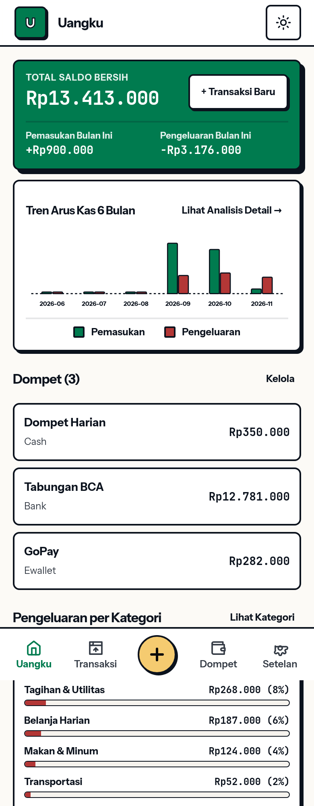
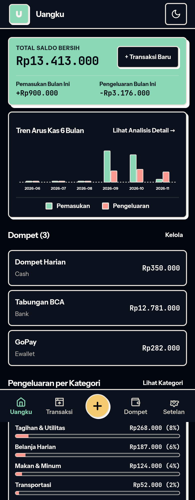

# Uangku

A personal finance tracker for Indonesian rupiah, built as one SvelteKit app on Cloudflare Workers with D1, KV, and a session per user.


Test deployment: https://akularping.my.id. Register with any email address. Do not enter real financial data there, it is a machine used for smoke tests.

 

The screenshots above come from the test deployment with sample data in it.

## What it does

- Records expenses, income, and transfers between wallets. Amounts are integer rupiah, never floats.
- Wallet balances are computed from transactions plus each wallet's starting balance. No balance column exists, so a balance cannot drift away from its transactions.
- 17 default categories (12 expense, 5 income) are inserted when an account is created. Older accounts are covered by a backfill migration.
- The transaction list is organized by month with arrow navigation, plus an "all" option and a custom date range. Rows are grouped per day, and each day shows its net total from a server side aggregate, so the number stays correct when one day spans two pages.
- Analytics page: presets (this week starting Monday, this month, this year, all, custom), daily, weekly, or monthly buckets, totals per category and per wallet, and a comparison against the previous period. Transfers count as neither income nor expense, because moving money between your own wallets is not a gain.
- Dashboard: total balance, current month cash flow, category breakdown, a six month bar chart drawn as plain SVG, and the latest transactions. The summary is cached in KV for 60 seconds and the key is deleted on every write.
- CSV export streams straight out of D1 with a UTF-8 BOM, CRLF line endings, and RFC 4180 escaping, so Excel opens it without broken characters.
- Email and password accounts through Better-Auth, with sessions in D1. Every page except `/login` and `/register` requires a session.
- Light and dark theme with a three state toggle (system, light, dark), applied by a small script in the document head so the page does not flash.
- Mobile first: bottom navigation, a center button that records a transaction from any screen, and touch targets of at least 44 px.

## Stack

| Layer | Choice | Reason |
|---|---|---|
| App | SvelteKit 3, Svelte 5 runes | Server side load functions and form actions; no client data layer to keep in sync |
| Runtime | Cloudflare Workers | Runs next to the database; the build ships static assets plus one worker |
| Database | D1 with Drizzle ORM | SQLite at the edge, typed queries, migrations as SQL files in the repo |
| Cache | Workers KV | 60 second dashboard summary, cleared on mutation |
| Auth | Better-Auth | Email and password sessions stored in D1 through the Drizzle adapter |
| Validation | Valibot | Smaller than Zod in a worker bundle |
| UI | Tailwind CSS 4, shadcn-svelte (Bits UI) | Design tokens in `@theme`, components restyled to `DESIGN.md` |
| Tests | Vitest with `@cloudflare/vitest-pool-workers` | Tests run inside workerd against real D1 and KV bindings |

## Quickstart

Node 22 or newer, npm, and a Cloudflare account for the deploy step.

```bash
git clone https://github.com/MasFana/uangku.git
cd uangku/uangku-app
npm ci

cp .dev.vars.example .dev.vars     # set BETTER_AUTH_SECRET to 32+ random characters

npx wrangler d1 create APP_DB      # put the printed id into wrangler.jsonc
npx wrangler kv namespace create CACHE
npx wrangler d1 migrations apply APP_DB --local
npm run db:seed:local              # optional demo account and sample data
npm run dev
```

The database ids committed in `uangku-app/wrangler.jsonc` belong to the original deployment. Create your own D1 and KV resources and replace those ids before you deploy.

## Repository layout

```
uangku/
├── AGENTS.md, DESIGN.md, PRODUCT.md, TEAM.md   working agreements, design tokens, agent roles
├── docs/                                       architecture, decisions, specs, test reports
├── .github/workflows/                          ci.yml (typecheck, build, tests), deploy.yml
├── scripts/check.sh                            local gate: typecheck, build, tests
└── uangku-app/                                 the SvelteKit app
    ├── src/lib/server/                         db, repos, services, and pure logic (balance, stats, period)
    ├── src/routes/                             pages, load functions, form actions
    ├── drizzle/                                generated SQL migrations
    └── tests/                                  Vitest suites
```

## Commands

Run these inside `uangku-app/`.

| Command | What it does |
|---|---|
| `npm run dev` | Vite dev server with Cloudflare bindings through `platformProxy` |
| `npm run check` | `svelte-kit sync` plus `svelte-check` |
| `npm test` | Vitest, one worker pool per suite |
| `npm run build` | Production build into `build/` |
| `npm run db:generate` | `drizzle-kit generate`, writes a new SQL migration |
| `npm run db:migrate:local` | Applies migrations to the local D1 |
| `npm run deploy` | `wrangler deploy` |
| `sh scripts/smoke.sh <url>` | Checks `/login`, `/api/auth/get-session`, and the redirect on `/` |

`npx drizzle-kit push` is not used here. Migrations are reviewed SQL files, so the schema and the deployed database cannot disagree by accident.

## Tests

`npm test` runs 120 tests across 13 files against real D1 and KV bindings inside workerd. The suites cover balance arithmetic including transfers, per user isolation, period resolution (month boundaries, February, year changes), daily aggregates, CSV escaping, default category seeding, the route guard, the dashboard cache, and analytics ranges.

## Deploy

```bash
npx wrangler d1 create APP_DB
npx wrangler kv namespace create CACHE
npx wrangler d1 migrations apply APP_DB --remote
npx wrangler secret put BETTER_AUTH_SECRET   # 32+ random characters
npx wrangler secret put BETTER_AUTH_URL      # https://your-worker-url
# optional, when the app answers on more than one hostname:
npx wrangler secret put BETTER_AUTH_TRUSTED_ORIGINS   # origin,origin
npm run deploy
```

`.github/workflows/deploy.yml` runs the same steps from the Actions tab when you start it by hand. It stays manual on purpose: a published template must not deploy to anyone's account on push. Add the repository secrets `CLOUDFLARE_API_TOKEN` and `CLOUDFLARE_ACCOUNT_ID` before you start it.

## Not built yet

Stated plainly, because a README that promises features the code does not have is worse than a short README:

- Receipt photos to R2. The `RECEIPTS` binding was removed from `wrangler.jsonc`, because R2 is turned off on this deployment account.
- AI monthly insight and receipt scanning. The secrets `AI_BASE_URL`, `AI_API_KEY`, and `AI_MODEL` are reserved in `.dev.vars.example`, and no code reads them yet.
- Budgets, tags with D1 FTS5 search, savings goals, recurring entries, multi currency, and offline PWA support.

Plans for those, with data models, are in `docs/specs/roadmap.md`.

## How this repo is built

The app was built by a small team of AI agent roles with a written contract: `AGENTS.md` (stack rules), `TEAM.md` (who owns which files), `DESIGN.md` (tokens, contrast, touch targets), and `docs/DECISIONS.md` (a decision log where every entry states the problem, the fix, and the evidence from production). `docs/specs/tasks.md` tracks the work row by row.

## Documentation

| Document | Language | Content |
|---|---|---|
| `docs/architecture.md` | English | Layers, data model, request flow, bindings, caching, money rules |
| `docs/development.md` | English | Setup, migrations, tests, deploy, troubleshooting |
| `docs/DECISIONS.md` | Indonesian | Decision log, including production bugs and their fixes |
| `docs/specs/` | Indonesian | Product requirements, roadmap, task list |
| `CONTRIBUTING.md` | English | How to propose a change and what the local gate runs |

## License

MIT, see `LICENSE`.
